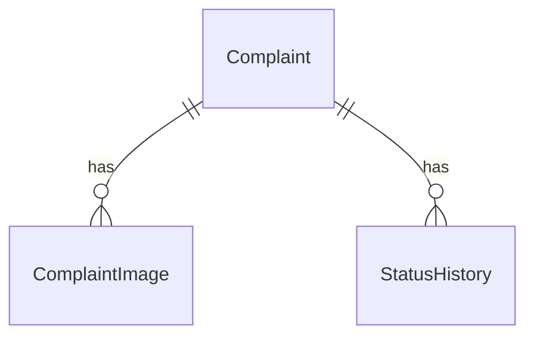

# Campus Helpdesk

**An electronic issue reporting system for campus facilities.**
Students report broken equipment anonymously and track progress with a private ticket. A single administrator manages complaints from a secure dashboard.


<!-- Add screenshots here, for example:


-->

---

## Table of contents

1. [Overview](#overview)
2. [Features](#features)
3. [Tech stack](#tech-stack)
4. [How it works](#how-it-works)
5. [Project structure](#project-structure)
6. [Getting started](#getting-started)
7. [Environment variables](#environment-variables)
8. [Database and migrations](#database-and-migrations)
9. [Running locally](#running-locally)
10. [Deployment (Vercel)](#deployment-vercel)
11. [Security and privacy](#security-and-privacy)
12. [API routes](#api-routes)
13. [Troubleshooting](#troubleshooting)
14. [Limitations and roadmap](#limitations-and-roadmap)
15. [License](#license)

---

## Overview

Reporting a broken projector or a dead Wi-Fi router usually means finding the right person, then wondering whether anyone ever read the message. Campus Helpdesk replaces that with a simple web app:

- A student fills in a short form, **with no registration or login**.
- The system issues a random **Ticket ID** and a separate secret **Tracking Token**.
- The student can return at any time, enter both, and see the current status and history.
- The administrator reviews, searches, filters, and updates complaints, and sees live statistics.

This is an **academic MVP**. It is deliberately simple: one administrator, three statuses, and no email or SMS notifications.

---

## Features

### Student side (public, no account)

- Clean, modern, responsive interface that works on phones.
- Complaint form: name, email, category, title, description, building, optional room number, and **up to 3 photos**.
- Categories: Computers, Projectors, Fans, Lights, Wi-Fi, Other.
- Photos are **compressed in the browser** before upload, which also removes hidden location (GPS) data.
- Random **Ticket ID** (for example `CH-7K3M-9PQ2`) plus a **secret tracking token**, shown once with copy and download buttons.
- Complaint tracking with **both** the ticket ID and the token, showing status, resolution note, photos, and a history timeline.
- Form validation, loading states, and clear error messages.

### Administrator side

- Single administrator login (credentials in environment variables, password stored as a bcrypt hash).
- Dashboard with live statistics: total complaints, counts per status, and a category report (donut and bar charts).
- Complaints list with **search** (ticket ID, title, name, email), **filters** (status, category, building), sorting, and pagination.
- Complaint detail page with student information, private photos, and full history.
- Three statuses: **Pending**, **In Progress**, **Resolved**.
- A **resolution note is required** when marking a complaint as Resolved.
- A resolved complaint can be reopened (back to Pending or In Progress).
- **Every status change is recorded** in the history timeline.

---

## Tech stack

| Area | Technology |
|---|---|
| Framework | Next.js 15 (App Router), React 19 |
| Language | TypeScript |
| Styling and icons | Tailwind CSS 4, Lucide React |
| Database | PostgreSQL on Supabase |
| ORM | Prisma 7 (with the `pg` driver adapter) |
| File storage | Supabase Storage (private bucket) |
| Admin authentication | `bcryptjs` (password hash) and `jose` (signed session cookie) |
| Validation and forms | Zod, React Hook Form |
| Charts | Recharts |
| Image handling | `browser-image-compression` (browser), `file-type` (server) |
| Hosting | Vercel |

---

## How it works

```
 Browser (React + Tailwind)
    │  HTTPS
    ▼
 Next.js on Vercel
   ├─ Pages (Server Components)  → read data and render HTML
   ├─ API Route Handlers (/api)  → validate, authorize, write data
   └─ Middleware                 → protects /admin pages
    │                    │
    │ Prisma             │ Supabase JS (service-role key, server only)
    ▼                    ▼
 Supabase PostgreSQL    Supabase Storage (PRIVATE bucket)
```

**Design rule:** the browser never talks to the database or to storage directly. It only talks to the Next.js server, which checks every request first.

**Anonymous submission and tracking**

1. The student submits the form. The server re-validates everything.
2. The server creates a random ticket ID and a 32-byte random token. **Only the SHA-256 hash of the token is stored**; the raw token is shown once and cannot be recovered.
3. To track, the student sends the ticket ID and token in a POST body (never in the URL). The server compares hashes in constant time. A wrong ticket and a wrong token give the same error message.

**Photo handling**

| Rule | Where it is enforced |
|---|---|
| Maximum 3 photos | Browser and server |
| Maximum 5 MB per original photo | Browser, before compression |
| Allowed types: JPEG, PNG, WebP | Browser (quick check) and server (real check from file contents) |
| Compression to about 1 MB | Browser |
| Maximum 1.2 MB per photo and about 4 MB per request | Server (fits Vercel's request-size limit) |
| Random file names in a private bucket | Server |
| Access only through links that expire after 5 minutes | Server, after the admin or ticket owner is verified |
| Cleanup if anything fails | Server removes uploaded files and the half-created complaint |

---

## Project structure

```
campus-helpdesk/
├─ prisma/
│  ├─ schema.prisma
│  └─ migrations/              # tables, then Row Level Security
├─ scripts/
│  └─ hash-password.mjs        # creates the admin password hash
├─ src/
│  ├─ app/
│  │  ├─ (public)/             # landing, submit, success, track
│  │  ├─ admin/
│  │  │  ├─ login/             # public login page
│  │  │  └─ (protected)/       # dashboard, complaints list and detail
│  │  └─ api/                  # complaints, track, admin/login, admin/logout, admin status
│  ├─ components/              # ui, complaint-form, tracking, admin
│  ├─ lib/                     # db, auth, session, tokens, images, supabase, rate-limit, stats, validation
│  ├─ types/
│  └─ middleware.ts            # protects /admin pages
├─ prisma.config.ts
├─ .env.example
└─ package.json
```

---

## Getting started

### Prerequisites

- **Node.js 20.19 or newer** (22 LTS recommended) and npm
- A free **Supabase** account: <https://supabase.com>
- Git

### 1. Get the code and install

```bash
git clone https://github.com/<your-username>/campus-helpdesk.git
cd campus-helpdesk
npm install
```

`npm install` also runs `prisma generate` automatically.

### 2. Create a Supabase project

1. Create a new project and save the database password.
2. Open **Connect** in the project and copy two connection strings:
   - **Transaction pooler** (port `6543`): this is `DATABASE_URL`.
   - **Session pooler** (port `5432`): this is `DIRECT_URL`. It works on IPv4 networks, unlike the "Direct connection" string.
3. In both strings, replace `[YOUR-PASSWORD]` with your database password.

### 3. Create the private storage bucket

1. Open **Storage → New bucket**.
2. Name it `complaint-images`.
3. Leave **Public bucket turned OFF**.
4. Optional extra safety: set a 2 MB file limit and allowed types `image/jpeg, image/png, image/webp`.
5. Do not add any storage policies. The server uses the service-role key and needs none.

Then open **Project Settings → API** and note the **Project URL** and the **service_role** (or "secret") key.

### 4. Configure environment variables

Copy the example file and fill in the values (see the next section):

```bash
# macOS / Linux
cp .env.example .env

# Windows (Command Prompt or PowerShell)
copy .env.example .env
```

### 5. Create the administrator account

```bash
npm run hash-password
```

Choose a password (at least 10 characters). The script prints three lines to paste into `.env`: `ADMIN_EMAIL`, `ADMIN_PASSWORD_HASH`, and `SESSION_SECRET`. Replace the example email with your own.

### 6. Create the database tables

```bash
npm run db:deploy
```

---

## Environment variables

All variables are **server-only**. None of them may start with `NEXT_PUBLIC_`, and `.env` must never be committed.

```env
# Database (Supabase > Connect)
DATABASE_URL=postgresql://postgres.<project-ref>:<password>@<region>.pooler.supabase.com:6543/postgres
DIRECT_URL=postgresql://postgres.<project-ref>:<password>@<region>.pooler.supabase.com:5432/postgres

# Image storage (Supabase > Project Settings > API)
SUPABASE_URL=https://<project-ref>.supabase.co
SUPABASE_SERVICE_ROLE_KEY=<your-service-role-key>
SUPABASE_STORAGE_BUCKET=complaint-images

# Administrator (generated by: npm run hash-password)
ADMIN_EMAIL=<admin-email>
ADMIN_PASSWORD_HASH=<bcrypt-hash-with-each-$-written-as-\$>
SESSION_SECRET=<random-string-of-at-least-32-characters>
```

| Variable | Purpose |
|---|---|
| `DATABASE_URL` | Pooled connection used by the running app |
| `DIRECT_URL` | Connection used only by Prisma migrations |
| `SUPABASE_URL` | Your Supabase project URL |
| `SUPABASE_SERVICE_ROLE_KEY` | Full-access storage key. **Never expose it to the browser.** |
| `SUPABASE_STORAGE_BUCKET` | Name of the private bucket |
| `ADMIN_EMAIL` | The single administrator's login email |
| `ADMIN_PASSWORD_HASH` | bcrypt hash of the administrator's password |
| `SESSION_SECRET` | Secret used to sign the login cookie |

> **Important: the `$` characters in the hash.**
> Next.js treats a bare `$` in `.env` as a variable. In your local `.env`, every `$` in the hash must be written as `\$`. The `hash-password` script prints it this way. On Vercel, paste the hash **without** backslashes. The script prints both versions.

---

## Database and migrations

Prisma is configured in `prisma.config.ts` and uses `DIRECT_URL` for migrations.

| Table | Purpose |
|---|---|
| `Complaint` | The complaint, hashed tracking token, status, and resolution note |
| `ComplaintImage` | Metadata of each uploaded photo (up to 3 per complaint) |
| `StatusHistory` | One row per status change, which powers the timeline |
| `RateLimit` | Small counters that slow down spam and password guessing |



Enums: `Status` (`PENDING`, `IN_PROGRESS`, `RESOLVED`) and `Category` (`COMPUTERS`, `PROJECTORS`, `FANS`, `LIGHTS`, `WIFI`, `OTHER`).

There are two migrations. The first creates the tables. The second enables **Row Level Security** on every table with no policies, which locks out Supabase's public API while the server's own connection keeps working.

```bash
npm run db:deploy    # apply all migrations
npm run db:status    # confirm the database is up to date
```

---

## Running locally

```bash
npm run dev
```

| Page | URL |
|---|---|
| Home | <http://localhost:3000> |
| Report an issue | <http://localhost:3000/submit> |
| Track a complaint | <http://localhost:3000/track> |
| Admin login | <http://localhost:3000/admin/login> |

Other scripts:

```bash
npm run typecheck    # TypeScript check
npm run lint         # ESLint
npm run build        # production build
npm run start        # run the production build
```

### Quick manual test

1. Submit a complaint with a photo and save the ticket ID and token.
2. Open `/track` and look it up with both values.
3. Log in as admin, open the complaint, set it to In Progress, then Resolved with a note.
4. Track it again and confirm the status, note, and history updated.
5. Check that the dashboard numbers match your data.

---

## Deployment (Vercel)

1. **Supabase:** complete the setup above (project, private bucket, keys).
2. **Database:** run `npm run db:deploy` on your computer with `DIRECT_URL` set. This creates the tables in the Supabase database that Vercel will use.
3. **GitHub:** push the project to a GitHub repository. Make sure `.env` is not included (it is listed in `.gitignore`).
4. **Vercel:** import the repository at <https://vercel.com/new>. The framework is detected as Next.js.
5. **Environment variables:** in the Vercel project settings, add all eight variables from the table above.
   - Paste `ADMIN_PASSWORD_HASH` **without** backslashes.
   - Use the pooled `DATABASE_URL` (port 6543).
6. **Deploy.** A `postinstall` script runs `prisma generate` during the build automatically.
7. **Region:** choose a Vercel region close to your Supabase region for faster responses.
8. **Verify on the live URL:** submit with photos, track, log in, change statuses (including reopening), view photos, and check the dashboard.

Later updates: every `git push` redeploys automatically. When you change the database schema, run `npm run db:deploy` yourself before or right after deploying.

> Vercel limits request bodies to about 4.5 MB, which is why photos are compressed in the browser and capped on the server.

---

## Security and privacy

- **Server-side validation** of every input with Zod. Browser checks are only a convenience.
- **Hashed tracking tokens** (SHA-256), compared in constant time. A lost token cannot be recovered, which is the trade-off of anonymity.
- **Random, non-sequential ticket IDs.**
- **Generic tracking errors:** a wrong ticket and a wrong token look identical.
- **Student privacy:** name and email are visible only to the administrator and are never returned by the tracking API.
- **Private images:** private bucket, random file names, links that expire after 5 minutes, and real file-type checks from file contents (SVG and GIF are rejected).
- **Metadata removal:** browser compression re-draws each photo, which strips GPS data.
- **Admin authentication:** bcrypt password check, signed JWT in an `httpOnly`, `SameSite=Lax` cookie (`Secure` in production), 8-hour expiry.
- **Two layers of protection:** middleware guards admin pages, and every admin page and API route verifies the session again on the server.
- **Rate limiting:** 20 submissions per hour per IP, 10 admin login attempts per 15 minutes per IP, and 10 failed tracking attempts per 15 minutes per IP. IP addresses are stored only as hashes.
- **Honeypot** field to reduce spam submissions.
- **Row Level Security** enabled on all tables, so Supabase's public API cannot read them.
- **Secrets stay on the server.** The service-role key is never sent to the browser.

---

## API routes

| Method and path | Access | Purpose |
|---|---|---|
| `POST /api/complaints` | Public, rate limited | Submit a complaint with optional photos |
| `POST /api/track` | Public, rate limited | Verify ticket ID and token, return permitted data |
| `POST /api/admin/login` | Public, rate limited | Verify admin credentials and set the session cookie |
| `POST /api/admin/logout` | Anyone | Clear the caller's own session cookie |
| `POST /api/admin/complaints/[id]/status` | **Admin only** | Change status, with a note and history entry |

---

## Troubleshooting

| Problem | Likely cause and fix |
|---|---|
| Admin login always fails | In `.env`, every `$` in `ADMIN_PASSWORD_HASH` must be written `\$`. Re-run `npm run hash-password` and copy the printed lines. The server log says when the hash is malformed. |
| "Too many attempts" while testing | Delete the matching row (key starts with `submit:`, `track:`, or `admin-login:`) in the `RateLimit` table. |
| Cannot connect to the database | Use the **Session pooler** string for `DIRECT_URL`. The "Direct connection" string is IPv6-only on many plans. Check that the password was substituted. |
| Photos fail to upload | Check `SUPABASE_URL`, the service-role key, and that the bucket `complaint-images` exists. |
| Photo links stop working | Links expire after 5 minutes. Refresh the page to get new ones. |
| `Unexpected eof` during build | A file was cut off while copying. Re-paste the file and make sure it ends with its final `}`. |
| Cookie not saved with `npm run start` on Safari | Safari rejects `Secure` cookies on plain `http://localhost`. Use `npm run dev`, or Chrome or Firefox. |

---

## Limitations and roadmap

**Current MVP limits**

- One administrator account, configured through environment variables.
- No email or SMS notifications, and lost tracking tokens cannot be recovered.
- Sessions cannot be revoked individually. Changing `SESSION_SECRET` logs everyone out.
- Rate limits are per IP address, so students sharing one campus network share the allowance.
- No automated test suite yet.

**Possible future enhancements**

- Student accounts and login
- Email or SMS notifications and token recovery
- Staff roles and complaint assignment
- Multiple administrators and audit logs
- Internal admin-only notes and replies
- Priority levels and response deadlines
- CSV or PDF export and date-range reports
- CAPTCHA and virus scanning for uploads

---


---

## Author

Mahnoor Kashif